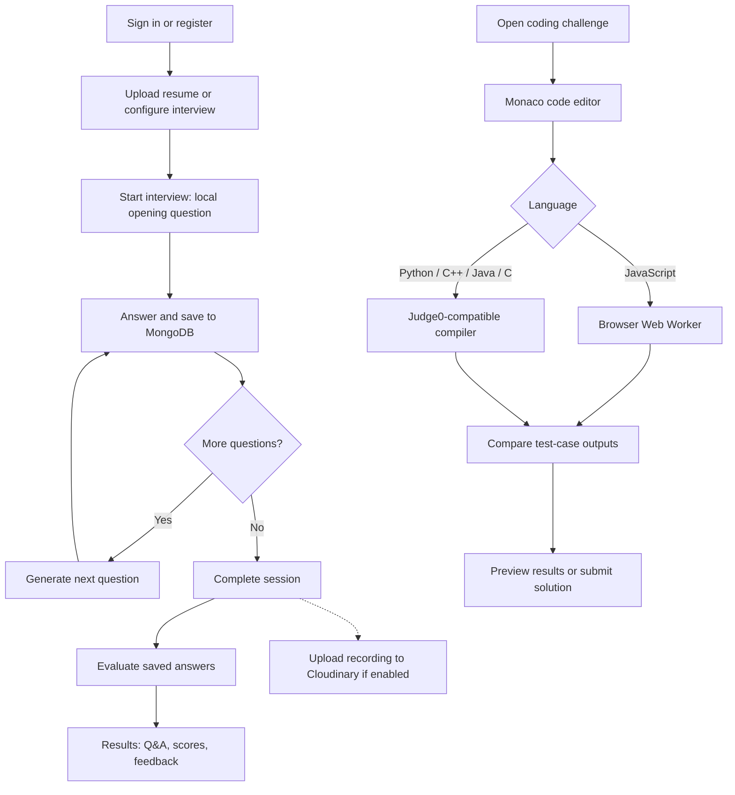

# PrepVerse — AI Mock Interview Platform

PrepVerse is a full-stack interview preparation application built with **React, TypeScript, Express, and MongoDB**. It combines resume-based interview practice, question generation, recorded sessions, coding challenges, and post-interview feedback.


## Features

| Feature | What it does |
|---|---|
| Resume analysis | Upload a PDF or DOCX, extract information, and analyze its relevance to a selected job role |
| Mock interviews | Configure the interview type, role, and difficulty; answer up to ten questions |
| Personalized questions | Start immediately with a locally prepared opening question; subsequent questions use Gemini/OpenAI when configured, with local fallbacks |
| Post-interview feedback | Save answers as the interview progresses; generate scores out of five and detailed feedback after finishing |
| Conversation & results | Review questions, answers, scores, and feedback together on the results page |
| Camera & recording | Optional camera/microphone capture, browser-based visual metrics, and Cloudinary upload when configured |
| Coding challenges | Edit and test JavaScript, Python, C++, Java, and C solutions without an AI grading requirement |
| Dashboard | View interview history, scores, and analytics |

AI grading is used for **interview answers**, not for coding test-case execution.

## How the application works



**Interview data flow:** The interview session and its questions are stored in MongoDB. New questions are checked against stored questions to reduce repetition, but semantically identical questions are not guaranteed to be eliminated. Answers are saved first; final evaluation may take additional time. If AI evaluation is unavailable, the application can use clearly labeled heuristic fallback feedback.

**Coding data flow:** JavaScript runs in a disposable browser Web Worker with a timeout. For Python, C++, Java, and C, the Express backend submits code to a **separate Judge0-compatible service**. The Node/Express application does not compile or execute those submitted programs. Preview does not finalize a coding session; **Submit Solution** does.

## Tech stack

| Layer | Technologies |
|---|---|
| Frontend | React 18, TypeScript, Vite, Tailwind CSS, Zustand, React Router, Framer Motion |
| Editor & analytics | Monaco Editor, Recharts |
| Browser features | Web Speech API, MediaRecorder, MediaPipe Tasks Vision |
| Backend | Node.js, Express, TypeScript, JWT, bcryptjs, multer |
| Database | MongoDB, Mongoose |
| Interview AI | Gemini API; OpenAI and local fallback paths |
| Recording storage | Cloudinary |
| Code execution | Browser Web Worker (JavaScript); Judge0-compatible compiler API (Python, C++, Java, C) |
| Deployment | Render (split frontend/backend or optional combined Web Service) |

## Repository layout

```text
AI-Mock-Interview-Platform/
├── backend/
│   ├── src/
│   │   ├── config/           # Database and environment config
│   │   ├── controllers/      # Authentication, resume, interview, video
│   │   ├── middleware/       # Auth, validation, uploads, rate limiting
│   │   ├── models/           # User, Resume, Interview
│   │   ├── routes/           # Express API routes
│   │   ├── services/         # Interview AI, resume parsing, coding execution
│   │   ├── utils/            # Coding challenge data and result comparison
│   │   └── index.ts          # Express entry point
│   ├── tests/
│   └── .env.example
├── frontend/
│   ├── src/
│   │   ├── components/       # Shared UI and conversation components
│   │   ├── hooks/
│   │   ├── lib/              # Browser JavaScript test runner
│   │   ├── pages/            # Interview, resume, coding, results, dashboard
│   │   ├── services/         # Axios API client
│   │   ├── store/
│   │   ├── types/
│   │   └── workers/          # Disposable JavaScript worker
│   └── vite.config.ts
├── .github/workflows/verify.yml
├── render.yaml               # Separate backend Web Service + frontend Static Site
├── render-single-service.yaml
├── package.json
└── README.md
```

## Local development

### Requirements

- **Node.js 20 or 22** recommended, with npm
- **MongoDB** running locally or available through MongoDB Atlas
- Optional Gemini/OpenAI credentials for personalized interview questions and evaluation
- Optional Cloudinary credentials for recording uploads
- A Judge0-compatible compiler endpoint for **Python, C++, Java, and C** coding tests

### 1. Clone and install

```bash
git clone https://github.com/anuragverma4895/AI-Mock-Interview-Platform.git
cd AI-Mock-Interview-Platform
npm run install:all
```

### 2. Set up backend environment

Copy `backend/.env.example` to `backend/.env` and replace the placeholders. The following is an example, **not** a valid set of production secrets:

```dotenv
PORT=5005
NODE_ENV=development
MONGODB_URI=mongodb://localhost:27017/ai-interview
JWT_SECRET=replace-with-a-long-random-secret

# Optional: personalized interview generation / answer evaluation
GEMINI_API_KEY=
OPENAI_API_KEY=

# Optional: recording storage
CLOUDINARY_CLOUD_NAME=
CLOUDINARY_API_KEY=
CLOUDINARY_API_SECRET=

# External coding compiler (Python, C++, Java, C)
JUDGE0_API_URL=
JUDGE0_AUTH_TOKEN=
JUDGE0_RAPIDAPI_KEY=
```

Use a Judge0 endpoint that your deployment is authorized to access. If you leave `JUDGE0_API_URL` unset, the current backend attempts the public Judge0 demonstration endpoint; it **may reject requests or be unavailable**. A dedicated service is recommended for reliable use.

### 3. Start both development servers

```bash
npm run dev
```

| Service | Local URL |
|---|---|
| React frontend | `http://localhost:3000` |
| Express API | `http://localhost:5005` |
| API health check | `http://localhost:5005/api/health` |

Vite proxies local `/api` requests to port `5005`. On deployment, the frontend uses `VITE_BACKEND_URL` if it is set.

To check builds and tests individually:

```bash
npm run build
cd backend && npm test
cd ../frontend && npm run test:runner
```

## Coding challenges

| Language | How test cases are executed | AI key needed? |
|---|---|---|
| JavaScript | Browser Web Worker (local practice runner) | No |
| Python | Judge0-compatible external execution | No |
| C++ | Judge0-compatible external execution | No |
| Java | Judge0-compatible external execution | No |
| C | Judge0-compatible external execution | No |

**Limitations:** An isolated compiler endpoint is required for the four non-JavaScript languages. The current harness supports common function signatures and JSON-style test inputs, but some advanced tree, graph, linked-list, or custom I/O questions require more adapters. JavaScript results originate in the browser and are **not tamper-proof competitive-programming grades**. The test runner checks available stored cases, not an exhaustive hidden test suite.

`Run Tests` previews results without ending the session. `Submit Solution` runs/submits the solution and completes the coding session. Compiler service authentication errors, quotas, or outages should be addressed through the compiler configuration rather than Gemini/OpenAI settings.

## Deploy to Render

There are **two different deployment layouts**. Choose one; do not mix the settings.

### Option A — Separate services (default `render.yaml`)

The default Blueprint describes:

1. **Backend:** Render Web Service, root directory `backend`, build `npm run build`, start `npm start`.
2. **Frontend:** Render Static Site, root directory `frontend`, build `npm ci && npm run build`, publish `dist`. Configure the rewrite `/*` to `/index.html` so React Router deep links work.

For the frontend Static Site, set:

```dotenv
VITE_BACKEND_URL=https://YOUR-BACKEND.onrender.com
```

For the backend Web Service, set:

```dotenv
NODE_ENV=production
SERVE_FRONTEND=false
FRONTEND_URL=https://YOUR-FRONTEND.onrender.com
MONGODB_URI=YOUR-MONGODB-URI
JWT_SECRET=YOUR-SECURE-SECRET
JUDGE0_API_URL=YOUR-AUTHORIZED-COMPILER-ENDPOINT
```

Add optional AI, Cloudinary, and compiler authentication credentials if those features are enabled.

**If the backend URL displays `Cannot GET /`:** the backend is an API service, not the website. The updated backend redirects `/` to `FRONTEND_URL` when configured, or returns API information if it is not. Open the **frontend Static Site URL** for the application.

### Option B — One combined Web Service (`render-single-service.yaml`)

A combined deployment uses **one URL** for React and Express:

| Setting | Value |
|---|---|
| Root directory | Repository root (leave empty) |
| Build command | `npm run build` |
| Start command | `npm start` |
| `NODE_ENV` | `production` |
| `SERVE_FRONTEND` | `true` |

The root build creates `frontend/dist` and `backend/dist`. Express serves React at `/`, React deep links through its SPA fallback, and API endpoints under `/api`.

Configure `MONGODB_URI`, `JWT_SECRET`, and optional compiler/AI/Cloudinary credentials in the Render dashboard. **Do not set `VITE_BACKEND_URL` to another origin for this combined setup**; the frontend uses same-origin `/api` by default.

> Pushing a new `render.yaml` does not automatically change the type or settings of a Render service that was created manually. Verify its Root Directory, build/start commands, environment, and latest deployed commit in the Render dashboard.

## Important API routes

All paths below use the `/api` prefix.

| Method | Route | Purpose |
|---|---|---|
| POST | `/auth/register` | Create an account |
| POST | `/auth/login` | Sign in |
| GET | `/auth/me` | Read authenticated profile |
| POST | `/resume/upload` | Upload a resume |
| POST | `/resume/analyze/:id` | Analyze resume for a role |
| POST | `/interview/start` | Create interview and opening question |
| POST | `/interview/submit-answer/:interviewId` | Save answer (no immediate grading) |
| GET | `/interview/next-question/:interviewId` | Advance after answering |
| POST | `/interview/end/:interviewId` | Complete interview |
| POST | `/interview/evaluate/:interviewId` | Evaluate saved answers for results |
| GET | `/interview/:id` | Fetch interview state and results |
| GET | `/coding/challenges` | List available challenges |
| POST | `/coding/start` | Start coding session |
| POST | `/coding/run/:interviewId` | Preview server-executed tests (non-JavaScript) |
| POST | `/coding/submit/:interviewId` | Finalize coding session |
| POST | `/demo/upload-recording/:interviewId` | Upload recording to Cloudinary |
| GET | `/health` | Health and database connection state |

Most account, resume, interview, and coding session endpoints require a valid JWT bearer token. JavaScript `Run Tests` runs on the frontend rather than calling the server preview endpoint.

## Verification and known limitations

```bash
# Backend: compile + unit tests
cd backend
npm test

# Frontend: JavaScript worker tests + production build
cd ../frontend
npm run test:runner
npm run build
```

The GitHub Actions workflow also checks selected MongoDB-backed API flows, coding harness compilation, and the combined React/Express root route.

- AI questions, feedback, and recording uploads depend on the configured external services.
- Some specialized coding signatures are not yet supported by the automatic harness.
- The app is for **interview practice**, not certified proctoring or tamper-resistant competitive grading.
- Protect real keys in environment variables. Do not commit `.env` files or secret values.
- Automated CI passing does **not** replace browser-level and production integration testing.
